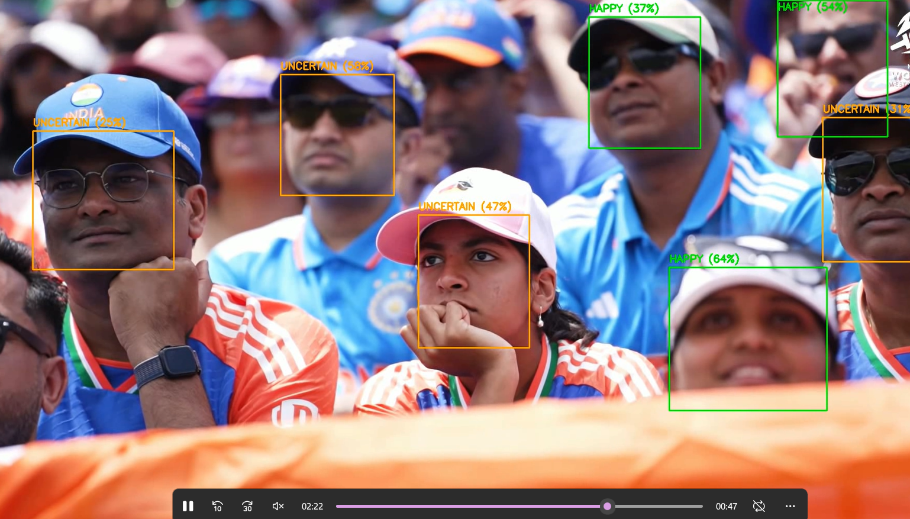

# Video Facial Expression Analysis

## 1. Methodology

Video Input → Frame Extraction → Face Detection → Expression Prediction → Frame Analysis → Result Generation

## 2. Description

The Video Facial Expression Analysis System analyzes video frames, detects human faces, predicts facial expressions using a pre-trained Hugging Face model, and generates a summary of the predictions.

**Technologies Used:** Python, OpenCV, Hugging Face Transformers, PyTorch.

## 3. Output

### Output 1

### Output 2

## 4. Example Output

**Frame-Level Summary:**
- Happy = 561
- Sad = 74
- Neutral = 14
- Uncertain = 595
- No Face = 1600

**Individual Face Predictions:**
- Happy = 1096
- Neutral = 66
- Sad = 160
- Uncertain = 791

**Total Analyzed Frames:** 2844

**Total Face Predictions:** 2113

**Processing Time:** 10.89 minutes
